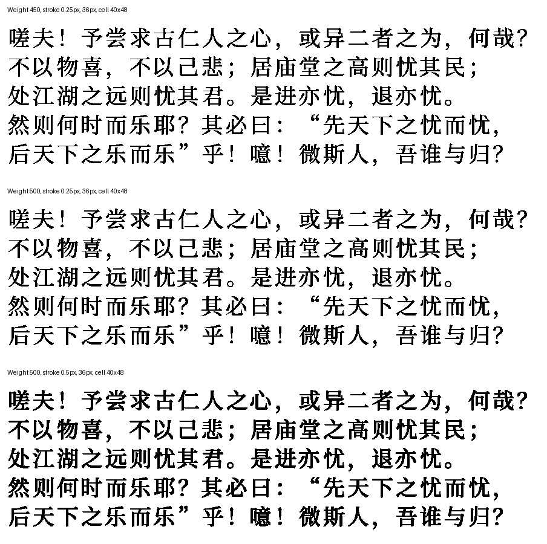

# XTEINK Font Maker

Convert TTF/OTF fonts to 1-bit BIN fonts for stock XTEINK firmware, with
adjustable variable-font weight and stroke expansion.

Install [uv](https://docs.astral.sh/uv/getting-started/installation/), then run:

```sh
uv run make_bin.py /path/to/font.otf
```

Defaults: weight 500, stroke expansion 0.5 px, glyph size 36 px, 40×48 cells.
BINs and PNG previews go to `output/`. Copy the BIN to your reader's font folder;
preserve the `_40x48.bin` suffix because the reader uses the dimensions.
Linux requires the FreeType shared library (`libfreetype6`). See `--help` for options.
Chinese punctuation preserves the source font's side bearings within each cell;
other glyphs retain their existing centering. BIN cells remain fixed-width.

Preview the three example settings without generating BINs:

```sh
uv run make_bin.py /path/to/font.otf --compare --preview-only
```



The sample is the closing passage of Fan Zhongyan's
[*岳阳楼记*](https://jjc.mku.edu.cn/info/1071/1971.htm), set in simplified Chinese
with modern punctuation. The same passage appears in each panel to compare
fine strokes, dense characters, and punctuation in normal reading.

These examples were generated from Source Han Serif SC version 2.003 at 36 px,
in 40×48 cells, as 1-bit fonts for stock XTEINK firmware. Each contains 65,536
Unicode BMP slots and is 15,728,640 bytes (15 MiB); missing characters are blank.
Rows below match the preview from top to bottom.

| Example name | Weight | Stroke expansion | Download |
| --- | ---: | ---: | --- |
| Reader Serif 450 Light | 450 | 0.25 px | [BIN](examples/fonts/SourceHanSerifSC_w450_stroke0p25_40x48.bin) |
| Reader Serif 500 Light | 500 | 0.25 px | [BIN](examples/fonts/SourceHanSerifSC_w500_stroke0p25_40x48.bin) |
| Reader Serif 500 Bold | 500 | 0.5 px | [BIN](examples/fonts/SourceHanSerifSC_w500_stroke0p5_40x48.bin) |

The Python app is [GPL-3.0-only](LICENSE). The converted example fonts are
separately licensed under [SIL OFL 1.1](examples/fonts/OFL.txt); see their
[notices](examples/fonts/NOTICE.md). Source OTF files are not included.
